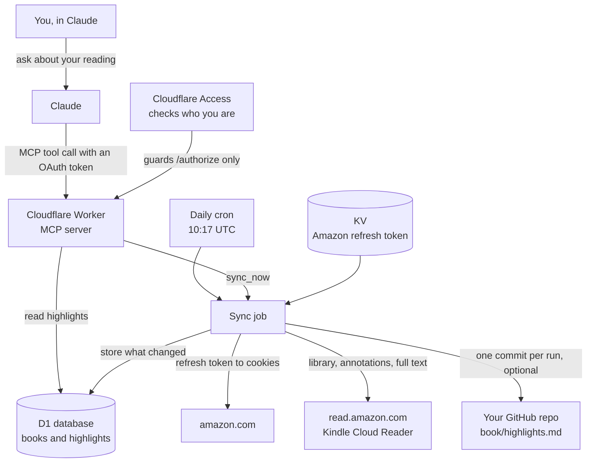
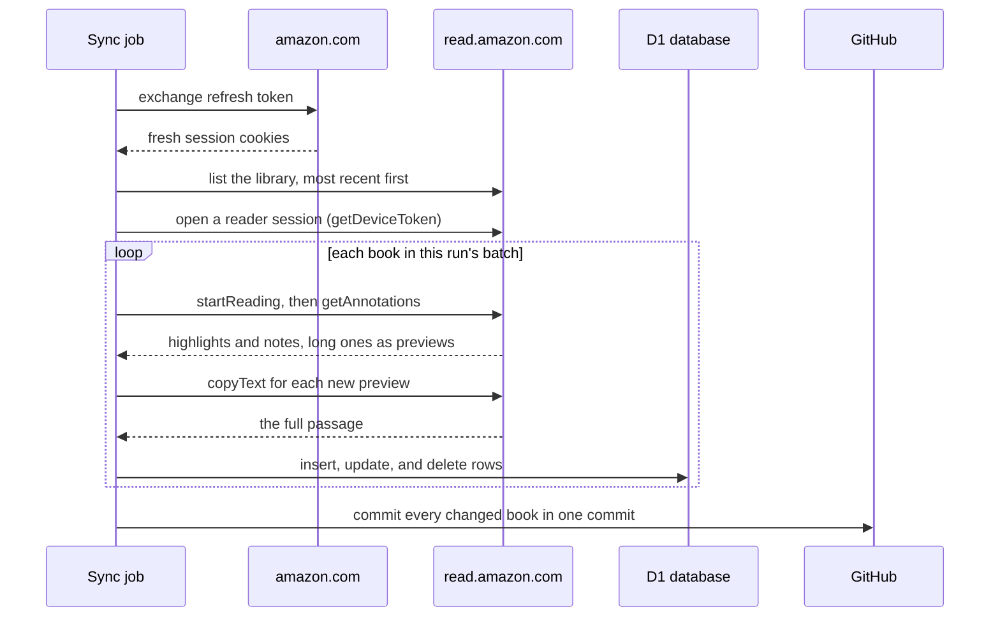

# Kindle highlights MCP server

A remote MCP server on Cloudflare Workers. It reads your Kindle highlights from Amazon once a day and serves them through MCP tools. It can also commit each changed book to a GitHub repo of yours as `<book>/highlights.md`.

Amazon has no public API for highlights. The server uses two private ones:

- **Device registration.** One browser sign-in registers the server as a Kindle device and returns a refresh token. The token lasts until you remove the device from your Amazon account or change your password. The server uses it to mint fresh amazon.com cookies on every run, so it stores no cookies.
- **Kindle Cloud Reader endpoints** on `read.amazon.com` for the library, each book's annotations, and the full text of long highlights.

This is unofficial. It may violate Amazon's terms, and it can break when Amazon changes either API. The refresh token is a standing grant on your Amazon account. The server stores it in the `KINDLE_KV` namespace.

## How it works

### What it looks like in Claude

Once the connector is added, you ask Claude about your reading in plain language, and Claude calls the tools. The examples below use sample highlights from two public-domain books. The text is what the server's own formatters return for that data.

You ask: *Which books do I have highlights in?* Claude calls `list_books`:

```text
2 books with highlights:
- Walden by Henry David Thoreau — 3 highlights [asin: B000EXAMPLE1, synced 2026-03-14]
- Essays: First Series by Ralph Waldo Emerson — 1 highlight [asin: B000EXAMPLE2, synced 2026-03-14]
```

You ask: *What have I highlighted about life?* Claude calls `search_highlights` with the query `life`:

```text
Highlights matching "life": 2

"I went to the woods because I wished to live deliberately, to front only the essential facts of life, and see if I could not learn what it had to teach, and not, when I came to die, discover that I had not lived."
Note: Compare with the opening of the Economy chapter.
(loc 1203, 2026-03-09, yellow)
— Walden, Henry David Thoreau

"Our life is frittered away by detail."
(loc 1221, 2026-03-09, yellow)
— Walden, Henry David Thoreau
```

Each result carries the Kindle location, the date, the highlight color, and any note you typed on the device.

### What lands in your GitHub repo

If you turn on the GitHub commit, each changed book becomes one markdown file. This is `walden/highlights.md` for the same sample data:

```markdown
# Walden

*Henry David Thoreau*

3 highlights · ASIN B000EXAMPLE1

---

> The mass of men lead lives of quiet desperation.

<sub>Location 112 · 2026-03-02</sub>

---

> I went to the woods because I wished to live deliberately, to front only the essential facts of life, and see if I could not learn what it had to teach, and not, when I came to die, discover that I had not lived.

**Note:** Compare with the opening of the Economy chapter.

<sub>Location 1203 · 2026-03-09</sub>

---

> Our life is frittered away by detail.

<sub>Location 1221 · 2026-03-09</sub>
```

The folder name comes from the book's title. The real file also has a one-line comment saying that the next sync overwrites it.

### The parts



- **The Worker** is one Cloudflare Worker. It serves the MCP endpoint at `/mcp`, runs the OAuth flow for the connector, and runs the sync job.
- **The read tools never call Amazon.** `list_books`, `get_highlights`, `search_highlights`, and `recent_highlights` read the D1 database, so they answer fast and keep working when Amazon is unreachable.
- **Only sync calls Amazon.** It runs on the daily cron, or when Claude calls `sync_now`.

### One sync run



The batch is the 5 most recently read books plus the next slice of a slow sweep through the rest of the library. A book you are reading now is checked every day. An older book is checked once per sweep, and a sweep takes several days for a large library.

### Two separate sign-ins

The server keeps two kinds of access apart.

- **Claude to the Worker.** Claude holds an OAuth token that the Worker issued. To get one, your browser passes through Cloudflare Access on `/authorize`, which checks that you are you. Anyone else is stopped at the Access login.
- **The Worker to Amazon.** The Worker holds an Amazon refresh token from a one-time device registration. Claude never sees it. The registration page and the debug pages sit behind `API_SECRET`.

Removing the device from your Amazon account cuts off the second one. Revoking the connector in Claude cuts off the first.

## Status

The server has run against a real amazon.com account, both from a laptop and from a deployed Worker. These points were checked:

| Question | Result |
|---|---|
| Does sign-in work in an ordinary browser? | Yes |
| Does `read.amazon.com` accept cookies minted from the refresh token? | Yes |
| Which id does `getDeviceToken` accept? | The Cloud Reader's device type, `A2CTZ977SKFQZY`, sent as both `serialNumber` and `deviceType`. It refuses the registered device's serial. |
| Does `read.amazon.com` accept a Worker's own `fetch`? | Yes. The fetch-proxy Container was not needed. |
| Does `copyText` return full passages? | Yes for most highlights. A few stay as previews. |

The fetch-proxy Container path is built but has only been run locally against fakes.

## Tools

| Tool | What it does |
|---|---|
| `list_books` | Books that have highlights or notes |
| `get_highlights` | Every highlight and note for one book, by title or ASIN |
| `search_highlights` | Search highlight and note text across all books |
| `recent_highlights` | Highlights made in the last N days |
| `sync_now` | Fetch from Amazon now (default: 10 most recently read books) |
| `sync_status` | Last runs, their results, and totals |

## 1. Check the Amazon route from your computer

```bash
npm install
npm run spike
```

The script prints a sign-in address. Open it and sign in. Amazon then shows a "page not found" screen at `amazon.com/ap/maplanding`. That screen is the expected result. Copy its full address and paste it into the script. The script registers a device, then prints PASS or FAIL for each step.

The script saves credentials to `.spike-credentials.json`, which is git-ignored. The device appears in your Amazon account as "Kindle highlights spike" under Manage Your Content and Devices, Devices.

If the plain sign-in link is refused, run `npm run spike -- --browser`. It signs in through Playwright, which plants the Kindle app's cookies.

## 2. Deploy

You need a Cloudflare account. The free Workers plan is enough unless you enable the fetch proxy.

```bash
npx wrangler kv namespace create KINDLE_KV          # put the id in wrangler.jsonc
npx wrangler kv namespace create KINDLE_OAUTH_KV    # put the id in wrangler.jsonc under OAUTH_KV
npx wrangler d1 create kindle-highlights            # put the id in wrangler.jsonc
npx wrangler d1 migrations apply kindle-highlights --remote
npx wrangler secret put API_SECRET                  # any long random string
npx wrangler deploy
```

Set `API_SECRET` before the first deploy. The Worker answers 500 on its `/auth`, `/debug`, and `/authorize` paths until the secret exists.

To keep your resource ids out of git, copy `wrangler.jsonc` to `wrangler.local.jsonc`, fill in the ids there, and pass `-c wrangler.local.jsonc` to each wrangler command. That file is git-ignored.

Then:

1. **Protect `/authorize` with Cloudflare Access.** In the Cloudflare dashboard, open Zero Trust, Access controls, Applications. Add a self-hosted application with one public hostname: your Worker's hostname with the path `authorize`. Give it a policy that allows only you. Protect that path only. Claude's servers call `/mcp`, `/token`, and `/register` directly, so Access must not cover them.
2. **Register with Amazon.** Open `https://<worker>/auth/<API_SECRET>/start` and sign in. If you already ran the spike, you can skip the second sign-in: `npx wrangler kv key put "amazon:credentials" --binding KINDLE_KV --remote --path .spike-credentials.json`.
3. **Probe.** Open `https://<worker>/debug/<API_SECRET>/probe`. Every step should be `"ok": true`.
4. **Run a first sync.** `curl -X POST "https://<worker>/debug/<API_SECRET>/sync?max=5"`.
5. **Add the connector.** In claude.ai, add `https://<worker>/mcp` as a custom connector. Keep the detected settings: sign in now, and register automatically.

Do step 1 before step 2. The connector's OAuth step trusts the `CF-Access-Authenticated-User-Email` header, and only Access makes that header trustworthy. Without Access, nobody can connect.

### Committing highlights to a GitHub repo

This part is optional. Without it, sync fills the database and the tools work.

1. Set `GITHUB_REPO` in `wrangler.jsonc` to the repo that should receive the files, as `owner/name`.
2. Create a fine-grained GitHub token with Contents read and write on that repo only.
3. Run `npx wrangler secret put GITHUB_TOKEN`, then deploy.

`GITHUB_BRANCH` is `main`, so sync commits go straight to the default branch. Point it at a test branch for the first runs if you want to read the output first. Each `<book>/highlights.md` file is overwritten on every sync, so keep hand-written notes in a different file.

### If the probe says `read.amazon.com` blocks the Worker

In `wrangler.jsonc`, uncomment the `FETCH_PROXY` binding, the `v2` migration, and the `containers` block. Then run `npx wrangler deploy`. This needs Docker running and the Workers Paid plan. Requests to `read.amazon.com` then go through `container/proxy.py`, which sends them with a Chrome TLS fingerprint. Check with `/debug/<API_SECRET>/probe?transport=proxy`.

To test the proxy locally:

```bash
docker build -t kindle-proxy container && docker run --rm -p 8080:8080 kindle-proxy
npm run spike -- --proxy http://localhost:8080
```

## How sync works

- It runs daily at 10:17 UTC (`triggers.crons`).
- Each run checks the 5 most recently read books plus the next slice of a sweep through the rest of the library, `SYNC_BATCH_SIZE` books in total (default 25). A large library is fully covered after several days.
- A highlight deleted on Kindle is deleted here.
- A long highlight arrives as a preview of about 100 characters. Sync asks for the full passage once and keeps it.
- Changed books are written in one commit. If the commit fails, the books stay marked and go out with the next run.

## Where secrets live

| Secret | Where |
|---|---|
| `API_SECRET`, `GITHUB_TOKEN` | Wrangler secrets on the Worker. For local dev, `.dev.vars` (git-ignored). |
| Amazon refresh token and device key | The `amazon:credentials` key in `KINDLE_KV` |
| Spike credentials | `.spike-credentials.json` (git-ignored) |

`API_SECRET` is part of the `/auth` and `/debug` addresses. Treat those addresses as passwords.

## Limits

- Purchased Kindle books only. Sideloaded documents have no text in the Cloud Reader.
- US store (`amazon.com`) only. Other stores need the constants in `src/amazon/device.ts` changed.
- Publishers cap how much of a book can be copied. Past that cap, highlights stay as previews and are marked `preview only`.

## Development

```bash
npm test          # vitest
npm run lint      # biome
npm run typecheck
npm run dev       # wrangler dev. Copy .dev.vars.example to .dev.vars first.
```

For `npm run dev`, apply the migration to the local database once: `npx wrangler d1 migrations apply kindle-highlights --local`.

## Credits

The device-registration flow is ported from [moifort/kindle-api-ts](https://github.com/moifort/kindle-api-ts) and the Cloud Reader client from [minholi/omakindle](https://github.com/minholi/omakindle), both MIT licensed.
